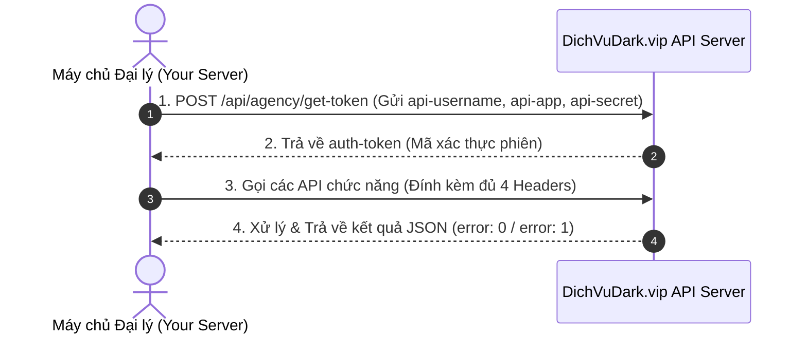

# 🚀 DichVuDark.vip - Tài Liệu Tích Hợp API Dịch Vụ (Cloud VPS, Tên Miền & Proxy)

> **Hệ thống API Agency & Reseller chuẩn dành cho Đại lý & Đối tác kết nối tự động hóa dịch vụ Cloud VPS & Tên Miền**  
> **Phiên bản:** API Protocol v2.0  
> **Base Domain:** `https://dichvudark.vip`  
> **Định dạng dữ liệu:** `JSON (UTF-8)`  
> **Trang tài liệu trên Web:** `/docs/api/vps-gold`, `/docs/api/domain` & `/docs/api/proxy`

---

## 📑 MỤC LỤC

- [1. Hướng Dẫn Xác Thực & Quy Tắc Chung (Cloud VPS)](#-1-hướng-dẫn-xác-thực--quy-tắc-chung)
  - [1.1. Giới thiệu mô hình API Agency](#11-giới-thiệu-mô-hình-api-agency)
  - [1.2. Bộ thông tin xác thực](#12-bộ-thông-tin-xác-thực)
  - [1.3. Quy trình xác thực 2 bước (Two-Step Agency Flow)](#13-quy-trình-xác-thực-2-bước-two-step-agency-flow)
  - [1.4. Quy chuẩn HTTP Headers bắt buộc](#14-quy-chuẩn-http-headers-bắt-buộc)
  - [1.5. Cấu trúc Response quy chuẩn](#15-cấu-trúc-response-quy-chuẩn)
- [2. Chi Tiết Các Endpoints Dịch Vụ Cloud VPS](#-2-chi-tiết-các-endpoints-dịch-vụ)
  - [2.1. Lấy Auth Token (`POST /api/agency/get-token`)](#-21-lấy-auth-token-post-apiagencyget-token)
  - [2.2. Thông tin tài khoản đại lý & Số dư (`GET /api/agency/get-info`)](#-22-thông-tin-tài-khoản-đại-lý--số-dư-get-apiagencyget-info)
  - [2.3. Danh sách gói Cloud VPS & Bảng giá (`GET /api/agency/get-product`)](#-23-danh-sách-gói-cloud-vps--bảng-giá-get-apiagencyget-product)
  - [2.4. Danh sách Hệ điều hành (`GET /api/agency/get-list-os`)](#-24-danh-sách-hệ-điều-hành-get-apiagencyget-list-os)
  - [2.5. Danh sách Chu kỳ thanh toán (`GET /api/agency/get-list-billing-cycle`)](#-25-danh-sách-chu-kỳ-thanh-toán-get-apiagencyget-list-billing-cycle)
  - [2.6. Tạo đơn hàng đặt mua Cloud VPS (`POST /api/agency/order/create-order`)](#-26-tạo-đơn-hàng-đặt-mua-cloud-vps-post-apiagencyordercreate-order)
  - [2.7. Thao tác & Điều khiển VPS (`POST /api/agency/vps/action-vps`)](#-27-thao-tác--điều-khiển-vps-post-apiagencyvpsaction-vps)
    - [2.7.1. Bật nguồn VPS (`action: on`)](#271-bật-nguồn-vps-action-on)
    - [2.7.2. Tắt nguồn VPS (`action: off`)](#272-tắt-nguồn-vps-action-off)
    - [2.7.3. Khởi động lại VPS (`action: restart`)](#273-khởi-động-lại-vps-action-restart)
    - [2.7.4. Cài lại Hệ điều hành (`action: rebuild` hoặc `reinstall`)](#274-cài-lại-hệ-điều-hành-action-rebuild-hoặc-reinstall)
    - [2.7.5. Gia hạn Cloud VPS (`action: renew-vps`)](#275-gia-hạn-cloud-vps-action-renew-vps)
    - [2.7.6. Nâng cấp cấu hình CPU / RAM / Disk (`action: addon-vps`)](#276-nâng-cấp-cấu-hình-cpu--ram--disk-action-addon-vps)
    - [2.7.7. Hủy & Hoàn tiền VPS 80% (`action: cancel`)](#277-hủy--hoàn-tiền-vps-80-action-cancel)
    - [2.7.8. Đổi Chip Intel Platinum (`action: platinum`)](#278-đổi-chip-intel-platinum-action-platinum)
    - [2.7.9. Bật / Tắt Ảo hóa VT (`action: enable-vt` / `disable-vt`)](#279-bật--tắt-ảo-hóa-vt-action-enable-vt--disable-vt)
    - [2.7.10. Đồng bộ ổ cứng (`action: extend-disk`)](#2710-đồng-bộ-ổ-cứng-action-extend-disk)
    - [2.7.11. Đổi địa chỉ IP VPS (`action: change-ip`)](#2711-đổi-địa-chỉ-ip-vps-action-change-ip)
  - [2.8. Danh sách Cloud VPS đang sở hữu (`GET /api/agency/vps/get-list-vps`)](#-28-danh-sách-cloud-vps-đang-sở-hữu-get-apiagencyvpsget-list-vps)
  - [2.9. Chi tiết cấu hình & Trạng thái VPS (`GET /api/agency/vps/get-info-vps`)](#-29-chi-tiết-cấu-hình--trạng-thái-vps-get-apiagencyvpsget-info-vps)
  - [2.10. Xem lịch sử thao tác trên VPS (`GET /api/agency/vps/history-action-vps`)](#-210-xem-lịch-sử-thao-tác-trên-vps-get-apiagencyvpshistory-action-vps)
- [3. Bảng Mã Lỗi & Hướng Dẫn Xử Lý](#-3-bảng-mã-lỗi--hướng-dẫn-xử-lý)
- [4. Code Mẫu Tích Hợp Cloud VPS](#-4-code-mẫu-tích-hợp-hoàn-chỉnh)
  - [4.1. PHP (Class SDK hoàn chỉnh)](#41-php-class-sdk-hoàn-chỉnh)
  - [4.2. Python 3 (Requests)](#42-python-3-requests)
  - [4.3. Node.js (Axios)](#43-nodejs-axios)
- [5. Tài Liệu Tích Hợp API Tên Miền (Domain API)](#-5-tài-liệu-tích-hợp-api-tên-miền-domain-api)
  - [5.1. Cơ chế xác thực Domain API](#51-cơ-chế-xác-thực-domain-api)
  - [5.2. Kiểm tra tên miền & Tra cứu giá (`GET /api/domain/check`)](#52-kiểm-tra-tên-miền--tra-cứu-giá-get-apidomaincheck)
  - [5.3. Bảng giá toàn bộ TLDs (`GET /api/domain/pricing`)](#53-bảng-giá-toàn-bộ-tlds-get-apidomainpricing)
  - [5.4. Đặt mua / Đăng ký tên miền tự động (`POST /api/domain/buy`)](#54-đặt-mua--đăng-ký-tên-miền-tự-động-post-apidomainbuy)
  - [5.5. Danh sách tên miền đã sở hữu (`GET /api/domain/list`)](#55-danh-sách-tên-miền-đã-sở-hữu-get-apidomainlist)
  - [5.7. Chi tiết tên miền & Tra cứu DNS (`GET /api/domain/details`)](#57-chi-tiết-tên-miền--tra-cứu-dns-get-apidomaindetails)
  - [5.8. Cập nhật bản ghi DNS (`POST /api/domain/dns`)](#58-cập-nhật-bản-ghi-dns-post-apidomaindns)
  - [5.9. Code mẫu tích hợp Domain API (PHP & Node.js)](#59-code-mẫu-tích-hợp-domain-api-php--nodejs)
- [6. Tài Liệu Tích Hợp API Proxy (Proxy API)](#-6-tài-liệu-tích-hợp-api-proxy-proxy-api)
  - [6.1. Hướng dẫn xác thực & Quy tắc chung (Proxy API)](#61-hướng-dẫn-xác-thực--quy-tắc-chung-proxy-api)
  - [6.2. Cơ chế tính giá & Biên lợi nhuận Đại lý](#62-cơ-chế-tính-giá--biên-lợi-nhuận-đại-lý)
  - [6.3. Lấy danh sách gói Proxy & Bảng giá (`GET /api/proxy/packages`)](#63-lấy-danh-sách-gói-proxy--bảng-giá-get-apiproxypackages)
  - [6.4. Đặt mua Proxy tự động (`POST /api/proxy/buy`)](#64-đặt-mua-proxy-tự-động-post-apiproxybuy)
  - [6.5. Danh sách Proxy đã mua (`GET /api/proxy/orders`)](#65-danh-sách-proxy-đã-mua-get-apiproxyorders)
  - [6.6. Tra cứu chi tiết Proxy theo ID (`GET /api/proxy/info`)](#66-tra-cứu-chi-tiết-proxy-theo-id-get-apiproxyinfo)
  - [6.7. Gia hạn Proxy (`POST /api/proxy/renew`)](#67-gia-hạn-proxy-post-apiproxyrenew)
  - [6.8. Đồng bộ / Làm mới địa chỉ IP (`POST /api/proxy/sync-ip`)](#68-đồng-bộ--làm-mới-địa-chỉ-ip-post-apiproxysync-ip)
  - [6.9. Kiểm tra Proxy Live / Die & Đo Ping (`POST /api/proxy/check`)](#69-kiểm-tra-proxy-live--die--đo-ping-post-apiproxycheck)
  - [6.10. Thông tin tài khoản & Số dư Proxy (`GET /api/proxy/profile`)](#610-thông-tin-tài-khoản--số-dư-proxy-get-apiproxyprofile)
  - [6.11. Code mẫu tích hợp Proxy API (PHP SDK & Node.js)](#611-code-mẫu-tích-hợp-proxy-api-php-sdk--nodejs)

---

## 🔐 1. Hướng Dẫn Xác Thực & Quy Tắc Chung

### 1.1. Giới thiệu mô hình API Agency
Hệ thống **API Agency** tại [DichVuDark.vip](https://dichvudark.vip) cho phép các đối tác, đại lý bán lại (Reseller) và lập trình viên kết nối trực tiếp hệ thống của mình tới cụm máy chủ Cloud VPS của chúng tôi để:
* Tự động đặt mua VPS ngay lập tức khi khách hàng của bạn thanh toán.
* Tự động quản lý vòng đời VPS: Khởi động, Tắt, Khởi động lại, Cài lại OS.
* Nâng cấp cấu hình (vCPU, RAM, SSD NVMe) và gia hạn gói tự động.
* Đồng bộ số dư tài khoản đại lý và chiết khấu ưu đãi riêng cho từng cấp bậc.

### 1.2. Bộ thông tin xác thực
Để sử dụng API Agency, bạn cần đăng nhập vào tài khoản trên website [https://dichvudark.vip](https://dichvudark.vip), truy cập menu **API Agency** (hoặc xem tại `/docs/api/vps-gold`) để tạo bộ 3 thông tin bảo mật:

| Thông tin | Mô tả | Định dạng ví dụ |
| :--- | :--- | :--- |
| `api-username` | Tên tài khoản định danh API của bạn | `user_1_7b89f2a` |
| `api-app` | Khóa ứng dụng (Key App) | `app_9d28e71c03...` |
| `api-secret` | Mã khóa bí mật (Secret Key) | `sec_4f910a28b6...` |

> [!CAUTION]
> Tuyệt đối không để lộ `api-secret` ra phía giao diện người dùng (Frontend JavaScript/HTML). Mọi yêu cầu gọi API phải được thực hiện từ phía máy chủ của bạn (Backend Server-to-Server).

---

### 1.3. Quy trình xác thực 2 bước (Two-Step Agency Flow)
Khác với API thường, chuẩn Agency hoạt động theo mô hình bắt tay 2 bước:



1. **Bước 1 (Lấy Token):** Gửi yêu cầu `POST /api/agency/get-token` với payload chứa `api-username`, `api-app`, `api-secret`. Hệ thống kiểm tra hợp lệ và cấp cho bạn một chuỗi `auth-token`.
2. **Bước 2 (Thực thi các nghiệp vụ):** Với tất cả các endpoint còn lại, bạn bắt buộc phải truyền **đầy đủ 4 Headers** trong mọi request.

---

### 1.4. Quy chuẩn HTTP Headers bắt buộc
Trừ endpoint `POST /api/agency/get-token`, **toàn bộ các API khác** đều yêu cầu 4 HTTP Headers sau:

```http
api-username: YOUR_API_USERNAME
api-app: YOUR_KEY_APP
api-secret: YOUR_API_SECRET
auth-token: YOUR_AUTH_TOKEN
Content-Type: application/json
```

> [!IMPORTANT]
> Tên headers sử dụng dấu gạch ngang (`-`) viết thường: `api-username`, `api-app`, `api-secret`, `auth-token`. Nếu thiếu bất kỳ header nào, hệ thống sẽ từ chối với mã HTTP `401 Unauthorized`.

---

### 1.5. Cấu trúc Response quy chuẩn

Hệ thống API Agency luôn trả về định dạng `JSON` thống nhất với mã lỗi chuẩn `error`:

#### ✅ Khi thành công:
Thuộc tính `error` mang giá trị `0`:
```json
{
  "error": 0,
  "message": "Thao tác thành công",
  "data": { ... }
}
```

#### ❌ Khi xảy ra lỗi:
Thuộc tính `error` mang giá trị `1` kèm thông điệp mô tả:
```json
{
  "error": 1,
  "message": "Số dư không đủ. Cần 150,000đ, hiện có 20,000đ"
}
```

---

## ⚡ 2. Chi Tiết Các Endpoints Dịch Vụ

---

### 🔑 2.1. Lấy Auth Token (`POST /api/agency/get-token`)
Endpoint bước đầu tiên để chứng thực thông tin tài khoản và nhận mã `auth-token`.

- **Endpoint:** `https://dichvudark.vip/api/agency/get-token`
- **HTTP Method:** `POST`
- **Headers:** `Content-Type: application/json`
- **Request Body (JSON):**

| Tham số | Kiểu dữ liệu | Bắt buộc | Mô tả |
| :--- | :--- | :---: | :--- |
| `api-username` | String | **Có** | Username tài khoản API |
| `api-app` | String | **Có** | Mã định danh ứng dụng (Key App) |
| `api-secret` | String | **Có** | Mã bí mật (Secret Key) |

#### 📝 Ví dụ cURL
```bash
curl -X POST "https://dichvudark.vip/api/agency/get-token" \
  -H "Content-Type: application/json" \
  -d '{
    "api-username": "user_demo",
    "api-app": "app_fa830bf982",
    "api-secret": "sec_82937cb10a"
  }'
```

####  Response thành công
```json
{
  "error": 0,
  "auth-token": "c7a8b6932840192eab8f93018247db1893c8a91"
}
```

#### ❌ Response thất bại
```json
{
  "error": 1,
  "message": "Invalid credentials"
}
```

---

### 👤 2.2. Thông tin tài khoản đại lý & Số dư (`GET /api/agency/get-info`)
Kiểm tra số dư khả dụng, tổng chi tiêu và thống kê số lượng Cloud VPS đang chạy của bạn.

- **Endpoint:** `https://dichvudark.vip/api/agency/get-info`
- **HTTP Method:** `GET`
- **Headers:** Yêu cầu đủ 4 headers chuẩn (`api-username`, `api-app`, `api-secret`, `auth-token`).

#### 📝 Ví dụ cURL
```bash
curl -X GET "https://dichvudark.vip/api/agency/get-info" \
  -H "api-username: user_demo" \
  -H "api-app: app_fa830bf982" \
  -H "api-secret: sec_82937cb10a" \
  -H "auth-token: c7a8b6932840192eab8f93018247db1893c8a91"
```

####  Response thành công
```json
{
  "error": 0,
  "message": "Lấy thông tin chi tiết đại lý thành công",
  "data": {
    "agency_name": "user_demo",
    "email": "agency@example.com",
    "total_service": 8,
    "credit": 1500000,
    "total_expenses": 3200000,
    "total_credit": 4700000,
    "service": {
      "vps": {
        "on": 6,
        "expire": 2,
        "total": 8
      }
    }
  }
}
```

---

### 📦 2.3. Danh sách gói Cloud VPS & Bảng giá (`GET /api/agency/get-product`)
Lấy danh sách các gói Cloud VPS đang bán, chi tiết cấu hình (vCPU, RAM, SSD, Băng thông) và bảng giá đã tự động tính toán theo mức chiết khấu của đại lý. Đồng thời trả về danh mục cấu hình nâng cấp (Addons).

- **Endpoint:** `https://dichvudark.vip/api/agency/get-product`
- **HTTP Method:** `GET`
- **Headers:** Đủ 4 headers chuẩn.

#### 📝 Ví dụ cURL
```bash
curl -X GET "https://dichvudark.vip/api/agency/get-product" \
  -H "api-username: user_demo" \
  -H "api-app: app_fa830bf982" \
  -H "api-secret: sec_82937cb10a" \
  -H "auth-token: c7a8b6932840192eab8f93018247db1893c8a91"
```

####  Response thành công
```json
{
  "error": 0,
  "products": {
    "vps": [
      {
        "group_product_name": "Cloud Server",
        "product": [
          {
            "product_id": 1,
            "name": "Cloud VPS 1",
            "cpu": "2 vCPU",
            "ram": "2 GB",
            "disk": "30 GB SSD",
            "ip": "1 IPv4 Riêng",
            "bandwidth": "Không giới hạn",
            "pricing": {
              "monthly": {
                "billing_cycle": "1 Tháng",
                "amount": 120000
              },
              "quarterly": {
                "billing_cycle": "3 Tháng",
                "amount": 345000
              },
              "semi_annually": {
                "billing_cycle": "6 Tháng",
                "amount": 660000
              },
              "annually": {
                "billing_cycle": "1 Năm",
                "amount": 1200000
              }
            }
          }
        ],
        "limit-os": [
          { "os-id": "101", "os-name": "Ubuntu 22.04 LTS" },
          { "os-id": "102", "os-name": "Windows Server 2022" },
          { "os-id": "103", "os-name": "CentOS 7 x64" }
        ]
      }
    ],
    "addon_vps": [
      {
        "group_product_name": "Addon Cloud Server",
        "product": [
          {
            "product_id": 1,
            "name": "Addon CPU",
            "type_addon": "addon_cpu",
            "pricing": {
              "monthly": { "billing_cycle": "1 Tháng", "amount": 30000 }
            }
          },
          {
            "product_id": 2,
            "name": "Addon RAM",
            "type_addon": "addon_ram",
            "pricing": {
              "monthly": { "billing_cycle": "1 Tháng", "amount": 20000 }
            }
          },
          {
            "product_id": 3,
            "name": "Addon Disk",
            "type_addon": "addon_disk",
            "pricing": {
              "monthly": { "billing_cycle": "1 Tháng", "amount": 10000 }
            }
          }
        ]
      }
    ]
  }
}
```

---

### 💿 2.4. Danh sách Hệ điều hành (`GET /api/agency/get-list-os`)
Lấy danh sách các hệ điều hành (Windows Server, Linux: Ubuntu, CentOS, Debian, AlmaLinux...) được hỗ trợ trên hệ thống.

- **Endpoint:** `https://dichvudark.vip/api/agency/get-list-os`
- **HTTP Method:** `GET`
- **Headers:** Đủ 4 headers chuẩn.

#### 📝 Ví dụ cURL
```bash
curl -X GET "https://dichvudark.vip/api/agency/get-list-os" \
  -H "api-username: user_demo" \
  -H "api-app: app_fa830bf982" \
  -H "api-secret: sec_82937cb10a" \
  -H "auth-token: c7a8b6932840192eab8f93018247db1893c8a91"
```

####  Response thành công
```json
{
  "error": 0,
  "os-vps": [
    { "os-id": "101", "os-name": "Ubuntu 22.04 LTS 64bit" },
    { "os-id": "102", "os-name": "Windows Server 2022 Datacenter" },
    { "os-id": "103", "os-name": "Windows Server 2019 Datacenter" },
    { "os-id": "104", "os-name": "Windows 10 Pro 64bit" },
    { "os-id": "105", "os-name": "CentOS 7 64bit" },
    { "os-id": "106", "os-name": "AlmaLinux 9 64bit" },
    { "os-id": "107", "os-name": "Debian 12 64bit" }
  ]
}
```

---

### 🗓️ 2.5. Danh sách Chu kỳ thanh toán (`GET /api/agency/get-list-billing-cycle`)
Lấy danh sách các chu kỳ thanh toán hợp lệ để truyền vào API đặt hàng.

- **Endpoint:** `https://dichvudark.vip/api/agency/get-list-billing-cycle`
- **HTTP Method:** `GET`
- **Headers:** Đủ 4 headers chuẩn.

#### 📝 Ví dụ cURL
```bash
curl -X GET "https://dichvudark.vip/api/agency/get-list-billing-cycle" \
  -H "api-username: user_demo" \
  -H "api-app: app_fa830bf982" \
  -H "api-secret: sec_82937cb10a" \
  -H "auth-token: c7a8b6932840192eab8f93018247db1893c8a91"
```

####  Response thành công
```json
{
  "error": 0,
  "billing-cycle": [
    { "cycle": "monthly", "name": "1 Tháng" },
    { "cycle": "quarterly", "name": "3 Tháng" },
    { "cycle": "semi_annually", "name": "6 Tháng" },
    { "cycle": "annually", "name": "1 Năm" }
  ]
}
```

---

### 🛒 2.6. Tạo đơn hàng đặt mua Cloud VPS (`POST /api/agency/order/create-order`)
Đặt mua một hoặc nhiều Cloud VPS mới. Hệ thống sẽ tự động trừ số dư tài khoản của bạn, khởi tạo VPS trên cụm hạ tầng và trả về IP, thông tin đăng nhập root/administrator ngay lập tức.

> [!NOTE]
> **Cơ chế Hoàn Tiền Bảo Vệ (Auto-Refund):** Nếu trong quá trình khởi tạo phía máy chủ vật lý gặp sự cố (ví dụ hết tài nguyên), hệ thống sẽ **ngay lập tức tự động hoàn lại 100% tiền** vào tài khoản của bạn và trả về thông báo lỗi.

- **Endpoint:** `https://dichvudark.vip/api/agency/order/create-order`
- **HTTP Method:** `POST`
- **Headers:** Đủ 4 headers chuẩn + `Content-Type: application/json`
- **Request Body (JSON):**

| Tham số | Kiểu dữ liệu | Bắt buộc | Mặc định | Mô tả |
| :--- | :--- | :---: | :---: | :--- |
| `product-id` | Integer | **Có** | - | ID gói VPS lấy từ API `/get-product` |
| `billing-cycle` | String | **Có** | - | Chu kỳ: `monthly`, `quarterly`, `semi_annually`, `annually` |
| `os` | String / Int | **Có** | - | ID Hệ điều hành từ `/get-list-os` (hoặc `limit-os`) |
| `quantity` | Integer | Không | `1` | Số lượng VPS cần mua (từ `1` đến `50`) |
| `addon-cpu` | Integer | Không | `0` | Số core vCPU muốn mua thêm |
| `addon-ram` | Integer | Không | `0` | Dung lượng RAM (GB) muốn mua thêm |
| `addon-disk` | Integer | Không | `0` | Số block SSD mua thêm (mỗi đơn vị là `10 GB SSD`) |

#### 📝 Ví dụ cURL
```bash
curl -X POST "https://dichvudark.vip/api/agency/order/create-order" \
  -H "api-username: user_demo" \
  -H "api-app: app_fa830bf982" \
  -H "api-secret: sec_82937cb10a" \
  -H "auth-token: c7a8b6932840192eab8f93018247db1893c8a91" \
  -H "Content-Type: application/json" \
  -d '{
    "product-id": 1,
    "billing-cycle": "monthly",
    "os": "101",
    "quantity": 1,
    "addon-cpu": 0,
    "addon-ram": 1,
    "addon-disk": 1
  }'
```

####  Response thành công
```json
{
  "error": 0,
  "message": "Đặt hàng thành công",
  "credit": 1350000,
  "total": 150000,
  "data": [
    {
      "vps-id": 7842,
      "ip": "103.179.188.94",
      "username": "root",
      "password": "N7x#qZ9_eK2!",
      "vps-status": "progressing"
    }
  ]
}
```

---

### ⚙️ 2.7. Thao tác & Điều khiển VPS (`POST /api/agency/vps/action-vps`)
Thực hiện toàn bộ các quyền điều khiển VPS: Khởi động nguồn, Tắt nguồn, Khởi động lại, Cài lại OS, Gia hạn và Nâng cấp cấu hình.

- **Endpoint:** `https://dichvudark.vip/api/agency/vps/action-vps`
- **HTTP Method:** `POST`
- **Headers:** Đủ 4 headers chuẩn + `Content-Type: application/json`

---

#### 2.7.1. Bật nguồn VPS (`action: on`)
Khởi động máy chủ ảo đang ở trạng thái tắt.

```bash
curl -X POST "https://dichvudark.vip/api/agency/vps/action-vps" \
  -H "api-username: user_demo" \
  -H "api-app: app_fa830bf982" \
  -H "api-secret: sec_82937cb10a" \
  -H "auth-token: c7a8b6932840192eab8f93018247db1893c8a91" \
  -H "Content-Type: application/json" \
  -d '{
    "vps-id": 7842,
    "action": "on"
  }'
```
Response:
```json
{
  "error": 0,
  "message": "Thao tác thành công"
}
```

---

#### 2.7.2. Tắt nguồn VPS (`action: off`)
Tắt nguồn máy chủ ảo.

```bash
curl -X POST "https://dichvudark.vip/api/agency/vps/action-vps" \
  -H "api-username: user_demo" \
  -H "api-app: app_fa830bf982" \
  -H "api-secret: sec_82937cb10a" \
  -H "auth-token: c7a8b6932840192eab8f93018247db1893c8a91" \
  -H "Content-Type: application/json" \
  -d '{
    "vps-id": 7842,
    "action": "off"
  }'
```
Response:
```json
{
  "error": 0,
  "message": "Thao tác thành công"
}
```

---

#### 2.7.3. Khởi động lại VPS (`action: restart`)
Reboot mềm máy chủ VPS.

```bash
curl -X POST "https://dichvudark.vip/api/agency/vps/action-vps" \
  -H "api-username: user_demo" \
  -H "api-app: app_fa830bf982" \
  -H "api-secret: sec_82937cb10a" \
  -H "auth-token: c7a8b6932840192eab8f93018247db1893c8a91" \
  -H "Content-Type: application/json" \
  -d '{
    "vps-id": 7842,
    "action": "restart"
  }'
```
Response:
```json
{
  "error": 0,
  "message": "Thao tác thành công"
}
```

---

#### 2.7.4. Cài lại Hệ điều hành (`action: rebuild` hoặc `reinstall`)
> [!WARNING]
> Hành động này sẽ **XÓA SẠCH DỮ LIỆU** và format lại ổ đĩa máy chủ ảo theo hệ điều hành được chỉ định. Hãy sao lưu dữ liệu quan trọng trước khi thực hiện.

Tham số bổ sung: `os` hoặc `os-id` (ID hệ điều hành từ `/get-list-os`).

```bash
curl -X POST "https://dichvudark.vip/api/agency/vps/action-vps" \
  -H "api-username: user_demo" \
  -H "api-app: app_fa830bf982" \
  -H "api-secret: sec_82937cb10a" \
  -H "auth-token: c7a8b6932840192eab8f93018247db1893c8a91" \
  -H "Content-Type: application/json" \
  -d '{
    "vps-id": 7842,
    "action": "rebuild",
    "os": "101"
  }'
```
Response:
```json
{
  "error": 0,
  "message": "Thao tác thành công"
}
```

---

#### 2.7.5. Gia hạn Cloud VPS (`action: renew-vps`)
Gia hạn thêm 1 chu kỳ thời gian sử dụng tiếp theo. Hệ thống tự động trừ tiền theo giá gói và chiết khấu của bạn.

```bash
curl -X POST "https://dichvudark.vip/api/agency/vps/action-vps" \
  -H "api-username: user_demo" \
  -H "api-app: app_fa830bf982" \
  -H "api-secret: sec_82937cb10a" \
  -H "auth-token: c7a8b6932840192eab8f93018247db1893c8a91" \
  -H "Content-Type: application/json" \
  -d '{
    "vps-id": 7842,
    "action": "renew-vps"
  }'
```
Response:
```json
{
  "error": 0,
  "message": "Gia hạn VPS thành công",
  "total": 120000
}
```

---

#### 2.7.6. Nâng cấp cấu hình CPU / RAM / Disk (`action: addon-vps`)
Nâng cấp thêm tài nguyên phần cứng cho VPS. Chi phí nâng cấp được **tính toán tự động theo tỷ lệ số ngày sử dụng còn lại** của chu kỳ hiện tại.

Tham số bổ sung:
* `addon-cpu`: Số vCPU nâng thêm (Integer)
* `addon-ram`: Số GB RAM nâng thêm (Integer)
* `addon-disk`: Số block SSD 10GB nâng thêm (Integer)

```bash
curl -X POST "https://dichvudark.vip/api/agency/vps/action-vps" \
  -H "api-username: user_demo" \
  -H "api-app: app_fa830bf982" \
  -H "api-secret: sec_82937cb10a" \
  -H "auth-token: c7a8b6932840192eab8f93018247db1893c8a91" \
  -H "Content-Type: application/json" \
  -d '{
    "vps-id": 7842,
    "action": "addon-vps",
    "addon-cpu": 1,
    "addon-ram": 2,
    "addon-disk": 1
  }'
```
Response:
```json
{
  "error": 0,
  "message": "Nâng cấp VPS thành công",
  "total": 48500
}
```

---

#### 2.7.7. Hủy & Hoàn tiền VPS 80% (`action: cancel`)
Hủy đơn hàng VPS và tự động hoàn trả **80% số tiền** ban đầu vào số dư tài khoản.

> [!IMPORTANT]
> Chỉ áp dụng hủy hoàn tiền đối với các VPS được mua **chưa quá 24 giờ** kể từ thời điểm thanh toán thành công.

```bash
curl -X POST "https://dichvudark.vip/api/agency/vps/action-vps" \
  -H "api-username: user_demo" \
  -H "api-app: app_fa830bf982" \
  -H "api-secret: sec_82937cb10a" \
  -H "auth-token: c7a8b6932840192eab8f93018247db1893c8a91" \
  -H "Content-Type: application/json" \
  -d '{
    "vps-id": 7842,
    "action": "cancel"
  }'
```
Response thành công:
```json
{
  "error": 0,
  "message": "Hủy VPS thành công, đã hoàn trả 80% số tiền vào tài khoản",
  "refund_amount": 120000,
  "original_price": 150000
}
```

---

#### 2.7.8. Đổi Chip Intel Platinum (`action: platinum`)
Yêu cầu chuyển đổi hạ tầng CPU của VPS sang cụm xử lý dòng **Intel Platinum** hiệu năng cao chuyên biệt cho các tác vụ nặng.

```bash
curl -X POST "https://dichvudark.vip/api/agency/vps/action-vps" \
  -H "api-username: user_demo" \
  -H "api-app: app_fa830bf982" \
  -H "api-secret: sec_82937cb10a" \
  -H "auth-token: c7a8b6932840192eab8f93018247db1893c8a91" \
  -H "Content-Type: application/json" \
  -d '{
    "vps-id": 7842,
    "action": "platinum"
  }'
```
Response thành công:
```json
{
  "error": 0,
  "message": "Đang xử lý cấu hình Chip Platinum...",
  "data": { ... }
}
```

---

#### 2.7.9. Bật / Tắt Ảo hóa VT (`action: enable-vt` / `disable-vt`)
Kích hoạt hoặc vô hiệu hóa công nghệ ảo hóa phần cứng (Intel VT-x / AMD-V) trên máy chủ ảo để hỗ trợ chạy giả lập Android (NoxPlayer, LDPlayer), Docker lồng, WSL2 hoặc các máy ảo con.

* **Bật ảo hóa VT:** `action: "enable-vt"`
* **Tắt ảo hóa VT:** `action: "disable-vt"`

```bash
curl -X POST "https://dichvudark.vip/api/agency/vps/action-vps" \
  -H "api-username: user_demo" \
  -H "api-app: app_fa830bf982" \
  -H "api-secret: sec_82937cb10a" \
  -H "auth-token: c7a8b6932840192eab8f93018247db1893c8a91" \
  -H "Content-Type: application/json" \
  -d '{
    "vps-id": 7842,
    "action": "enable-vt"
  }'
```
Response thành công:
```json
{
  "error": 0,
  "message": "Đang tiến hành Bật VT...",
  "action": "on",
  "data": { ... }
}
```

---

#### 2.7.10. Đồng bộ ổ cứng (`action: extend-disk`)
Mở rộng và đồng bộ phân vùng đĩa trong hệ điều hành sau khi bạn nâng cấp thêm dung lượng SSD NVMe.

Tham số bắt buộc:
* `password`: Mật khẩu hiện tại của VPS
* `username`: Tên tài khoản VPS (tùy chọn, mặc định `root`)

```bash
curl -X POST "https://dichvudark.vip/api/agency/vps/action-vps" \
  -H "api-username: user_demo" \
  -H "api-app: app_fa830bf982" \
  -H "api-secret: sec_82937cb10a" \
  -H "auth-token: c7a8b6932840192eab8f93018247db1893c8a91" \
  -H "Content-Type: application/json" \
  -d '{
    "vps-id": 7842,
    "action": "extend-disk",
    "password": "YourVpsPassword123"
  }'
```
Response thành công:
```json
{
  "error": 0,
  "message": "Đồng bộ ổ cứng VPS thành công"
}
```

---

#### 2.7.11. Đổi địa chỉ IP VPS (`action: change-ip`)
Yêu cầu cấp phát và gán địa chỉ IPv4 mới cho VPS.

> [!NOTE]
> * VPS **bắt buộc phải đang ở trạng thái BẬT (ON)**.
> * Mức phí đổi IP (nếu hệ thống thiết lập) sẽ tự động trừ trực tiếp từ số dư tài khoản và hoàn lại 100% nếu thao tác thất bại.

Tham số bắt buộc:
* `password`: Mật khẩu hiện tại của VPS

```bash
curl -X POST "https://dichvudark.vip/api/agency/vps/action-vps" \
  -H "api-username: user_demo" \
  -H "api-app: app_fa830bf982" \
  -H "api-secret: sec_82937cb10a" \
  -H "auth-token: c7a8b6932840192eab8f93018247db1893c8a91" \
  -H "Content-Type: application/json" \
  -d '{
    "vps-id": 7842,
    "action": "change-ip",
    "password": "YourVpsPassword123"
  }'
```
Response thành công:
```json
{
  "error": 0,
  "message": "Yêu cầu đổi IP đã được tiếp nhận, hệ thống sẽ xử lý sớm!",
  "fee": 0
}
```

---

### 📋 2.8. Danh sách Cloud VPS đang sở hữu (`GET /api/agency/vps/get-list-vps`)
Lấy danh sách tất cả các máy chủ VPS mà tài khoản của bạn đang sở hữu, kèm trạng thái, IP, cấu hình và thời hạn sử dụng. Hỗ trợ phân trang và lọc theo trạng thái.

- **Endpoint:** `https://dichvudark.vip/api/agency/vps/get-list-vps`
- **HTTP Method:** `GET`
- **Headers:** Đủ 4 headers chuẩn.
- **Tham số Query:**

| Tham số | Kiểu dữ liệu | Mặc định | Mô tả |
| :--- | :--- | :---: | :--- |
| `type` | String | `all` | Bộ lọc trạng thái: `all` (Tất cả), `dang-su-dung` (Đang hoạt động), `het-han` (Đã hết hạn) |
| `qtt` | Integer | `30` | Số lượng bản ghi trên một trang (Tối đa: `300`) |
| `page` | Integer | `0` | Trang cần lấy (Bắt đầu từ `0`) |

#### 📝 Ví dụ cURL
```bash
curl -X GET "https://dichvudark.vip/api/agency/vps/get-list-vps?type=all&qtt=30&page=0" \
  -H "api-username: user_demo" \
  -H "api-app: app_fa830bf982" \
  -H "api-secret: sec_82937cb10a" \
  -H "auth-token: c7a8b6932840192eab8f93018247db1893c8a91"
```

####  Response thành công
```json
{
  "error": 0,
  "message": "Lấy danh sách VPS thành công",
  "list-service": [
    {
      "vps-id": 7842,
      "ip": "103.179.188.94",
      "cpu": "3 vCPU",
      "ram": "4 GB",
      "disk": "40 GB",
      "text-config": "3 CPU - 4 RAM - 40 Disk",
      "date_create": "2026-05-31 20:47:00",
      "next_due_date": "2026-06-30 20:47:00",
      "billing-cycle": "monthly",
      "day-left": "Còn hạn 30 ngày",
      "vps-status": "on",
      "amount": "168,500",
      "username": "root",
      "password": "N7x#qZ9_eK2!",
      "auto-renew": 0,
      "type-vps": "VPS"
    }
  ]
}
```

---

### 🔍 2.9. Chi tiết cấu hình & Trạng thái VPS (`GET /api/agency/vps/get-info-vps`)
Lấy thông tin chi tiết thời gian thực của một hoặc nhiều VPS, bao gồm trạng thái hoạt động thực tế trên máy chủ vật lý, thông tin tài khoản root/admin, IP và ngày hết hạn.

- **Endpoint:** `https://dichvudark.vip/api/agency/vps/get-info-vps`
- **HTTP Method:** `GET` (Hoặc có thể truyền JSON body)
- **Headers:** Đủ 4 headers chuẩn.
- **Tham số Query:**

| Tham số | Kiểu dữ liệu | Bắt buộc | Mô tả |
| :--- | :--- | :---: | :--- |
| `vps-id` | Integer / Array | **Có** | ID VPS cần xem (Ví dụ: `?vps-id=7842`) |

#### 📝 Ví dụ cURL
```bash
curl -X GET "https://dichvudark.vip/api/agency/vps/get-info-vps?vps-id=7842" \
  -H "api-username: user_demo" \
  -H "api-app: app_fa830bf982" \
  -H "api-secret: sec_82937cb10a" \
  -H "auth-token: c7a8b6932840192eab8f93018247db1893c8a91"
```

####  Response thành công
```json
{
  "error": 0,
  "message": "Yêu cầu đến VPS thành công",
  "data": [
    {
      "vps-id": 7842,
      "ip": "103.179.188.94",
      "cpu": 3,
      "ram": 4,
      "disk": 40,
      "bandwidth": "Unlimited",
      "vps-status": "on",
      "username": "root",
      "password": "N7x#qZ9_eK2!",
      "date_create": "2026-05-31 20:47:00",
      "next_due_date": "2026-06-30 20:47:00",
      "day-left": "Còn hạn 30 ngày"
    }
  ]
}
```

---

### 📜 2.10. Xem lịch sử thao tác trên VPS (`GET /api/agency/vps/history-action-vps`)
Xem nhật ký toàn bộ các hành động đã thực hiện trên máy chủ ảo (Khởi động, Tắt, Khởi động lại, Cài lại OS, Gia hạn, Nâng cấp...).

- **Endpoint:** `https://dichvudark.vip/api/agency/vps/history-action-vps`
- **HTTP Method:** `GET`
- **Headers:** Đủ 4 headers chuẩn.
- **Tham số Query:**

| Tham số | Kiểu dữ liệu | Bắt buộc | Mô tả |
| :--- | :--- | :---: | :--- |
| `vps-id` | Integer | **Có** | ID VPS cần tra cứu lịch sử (Ví dụ: `?vps-id=7842`) |

#### 📝 Ví dụ cURL
```bash
curl -X GET "https://dichvudark.vip/api/agency/vps/history-action-vps?vps-id=7842" \
  -H "api-username: user_demo" \
  -H "api-app: app_fa830bf982" \
  -H "api-secret: sec_82937cb10a" \
  -H "auth-token: c7a8b6932840192eab8f93018247db1893c8a91"
```

####  Response thành công
```json
{
  "error": 0,
  "message": "Lấy lịch sử thao tác VPS thành công",
  "data": [
    {
      "id": 1823,
      "action": "Agency API - Nâng cấp VPS ID 7842 giá 48,500đ",
      "created_at": "2026-06-02 14:22:10"
    },
    {
      "id": 1810,
      "action": "Agency API - Restart VPS ID 7842",
      "created_at": "2026-06-01 09:12:05"
    },
    {
      "id": 1795,
      "action": "Agency API - Mua gói Cloud VPS 1 giá 120,000đ",
      "created_at": "2026-05-31 20:47:00"
    }
  ]
}
```

---

## ⚠️ 3. Bảng Mã Lỗi & Hướng Dẫn Xử Lý

| Thông báo lỗi (`message`) | HTTP Status | Nguyên nhân & Hướng khắc phục |
| :--- | :---: | :--- |
| `Missing required fields: api-username, api-app, api-secret` | `400` | Chưa truyền đủ 3 tham số trong body JSON khi gọi `POST /api/agency/get-token`. |
| `Missing required headers: api-username, api-app, api-secret, auth-token` | `401` | Request thiếu 1 trong 4 headers bắt buộc. Kiểm tra lại headers gửi lên. |
| `Invalid credentials` | `401` | Sai thông tin tài khoản API, Key App hoặc Secret Key. Hãy kiểm tra lại tại `/docs/api/vps-gold`. |
| `Account is banned` | `403` | Tài khoản của bạn đã bị khóa hoặc tạm dừng. Liên hệ quản trị viên để mở lại. |
| `Method not allowed. Use GET/POST` | `405` | Gọi sai HTTP Method (ví dụ endpoint yêu cầu `POST` nhưng gọi bằng `GET`). |
| `Thiếu trường bắt buộc: product-id` | `200` | Chưa truyền `product-id` trong JSON body khi tạo đơn mua VPS. |
| `Thiếu trường bắt buộc: billing-cycle` | `200` | Chưa truyền chu kỳ thanh toán hợp lệ (`monthly`, `quarterly`, `semi_annually`, `annually`). |
| `Sản phẩm không tồn tại` | `200` | ID gói VPS không tồn tại hoặc đã ngừng kinh doanh. Lấy lại ID từ `/get-product`. |
| `Số dư không đủ. Cần ...đ, hiện có ...đ` | `200` | Số dư trong ví tài khoản không đủ để thanh toán. Nạp thêm tiền tại website trước khi gọi API. |
| `Không tìm thấy thông tin VPS hoặc VPS không thuộc quyền sở hữu` | `200` | `vps-id` không tồn tại trên hệ thống hoặc VPS này thuộc về tài khoản người dùng khác. |
| `VPS đã hết hạn, vui lòng gia hạn trước` | `200` | VPS đang ở trạng thái `expire`. Bạn cần thực hiện hành động `renew-vps` trước khi bật nguồn hoặc rebuild. |

---

## 💻 4. Code Mẫu Tích Hợp Hoàn Chỉnh

### 4.1. PHP (Class SDK hoàn chỉnh)

Bạn có thể lưu đoạn code sau thành file `DichVuDarkAgency.php` để tích hợp vào hệ thống PHP của mình:

```php
<?php
/**
 * DichVuDark.vip Agency API Client
 * Tích hợp kết nối API Cloud VPS chuẩn Agency
 */
class DichVuDarkAgency {
    private string $baseUrl = 'https://dichvudark.vip';
    private string $apiUsername;
    private string $apiApp;
    private string $apiSecret;
    private ?string $authToken = null;

    public function __construct(string $username, string $appKey, string $secretKey) {
        $this->apiUsername = $username;
        $this->apiApp      = $appKey;
        $this->apiSecret   = $secretKey;
    }

    /**
     * 1. Lấy Auth Token
     */
    public function authenticate(): bool {
        $url = $this->baseUrl . '/api/agency/get-token';
        $payload = [
            'api-username' => $this->apiUsername,
            'api-app'      => $this->apiApp,
            'api-secret'   => $this->apiSecret,
        ];

        $res = $this->request('POST', $url, $payload, false);
        if (isset($res['error']) && $res['error'] === 0 && !empty($res['auth-token'])) {
            $this->authToken = $res['auth-token'];
            return true;
        }
        return false;
    }

    /**
     * 2. Lấy thông tin tài khoản & số dư
     */
    public function getAccountInfo(): array {
        return $this->request('GET', $this->baseUrl . '/api/agency/get-info');
    }

    /**
     * 3. Lấy danh sách gói VPS & Bảng giá
     */
    public function getProducts(): array {
        return $this->request('GET', $this->baseUrl . '/api/agency/get-product');
    }

    /**
     * 4. Lấy danh sách Hệ điều hành
     */
    public function getListOS(): array {
        return $this->request('GET', $this->baseUrl . '/api/agency/get-list-os');
    }

    /**
     * 5. Đặt mua Cloud VPS mới
     */
    public function createOrder(int $productId, string $cycle, string $osId, int $quantity = 1, int $cpu = 0, int $ram = 0, int $disk = 0): array {
        $payload = [
            'product-id'    => $productId,
            'billing-cycle' => $cycle,
            'os'            => $osId,
            'quantity'      => $quantity,
            'addon-cpu'     => $cpu,
            'addon-ram'     => $ram,
            'addon-disk'    => $disk,
        ];
        return $this->request('POST', $this->baseUrl . '/api/agency/order/create-order', $payload);
    }

    /**
     * 6. Thao tác điều khiển VPS
     */
    public function actionVps(int $vpsId, string $action, array $extraParams = []): array {
        $payload = array_merge([
            'vps-id' => $vpsId,
            'action' => $action
        ], $extraParams);
        return $this->request('POST', $this->baseUrl . '/api/agency/vps/action-vps', $payload);
    }

    /**
     * 6.1. Hủy & hoàn tiền VPS 80% (trong vòng 24h)
     */
    public function cancelVps(int $vpsId): array {
        return $this->actionVps($vpsId, 'cancel');
    }

    /**
     * 6.2. Đổi chip CPU sang Intel Platinum
     */
    public function switchPlatinum(int $vpsId): array {
        return $this->actionVps($vpsId, 'platinum');
    }

    /**
     * 6.3. Bật / Tắt ảo hóa phần cứng VT
     */
    public function setVirtualization(int $vpsId, bool $enable = true): array {
        return $this->actionVps($vpsId, $enable ? 'enable-vt' : 'disable-vt');
    }

    /**
     * 6.4. Đồng bộ ổ cứng sau nâng cấp
     */
    public function extendDisk(int $vpsId, string $password, string $username = 'root'): array {
        return $this->actionVps($vpsId, 'extend-disk', ['password' => $password, 'username' => $username]);
    }

    /**
     * 6.5. Đổi địa chỉ IPv4 mới cho VPS
     */
    public function changeIp(int $vpsId, string $password): array {
        return $this->actionVps($vpsId, 'change-ip', ['password' => $password]);
    }

    /**
     * 7. Lấy danh sách VPS sở hữu
     */
    public function getListVps(string $type = 'all', int $qtt = 30, int $page = 0): array {
        $query = http_build_query(['type' => $type, 'qtt' => $qtt, 'page' => $page]);
        return $this->request('GET', $this->baseUrl . '/api/agency/vps/get-list-vps?' . $query);
    }

    /**
     * 8. Chi tiết VPS theo ID
     */
    public function getInfoVps(int $vpsId): array {
        return $this->request('GET', $this->baseUrl . '/api/agency/vps/get-info-vps?vps-id=' . $vpsId);
    }

    /**
     * Hàm gọi cURL nội bộ
     */
    private function request(string $method, string $url, array $data = [], bool $withHeaders = true): array {
        if ($withHeaders && empty($this->authToken)) {
            if (!$this->authenticate()) {
                return ['error' => 1, 'message' => 'Xác thực tài khoản API thất bại'];
            }
        }

        $ch = curl_init();
        curl_setopt($ch, CURLOPT_URL, $url);
        curl_setopt($ch, CURLOPT_RETURNTRANSFER, true);
        curl_setopt($ch, CURLOPT_SSL_VERIFYPEER, false);
        curl_setopt($ch, CURLOPT_TIMEOUT, 30);

        $headers = ['Content-Type: application/json'];
        if ($withHeaders) {
            $headers[] = 'api-username: ' . $this->apiUsername;
            $headers[] = 'api-app: ' . $this->apiApp;
            $headers[] = 'api-secret: ' . $this->apiSecret;
            $headers[] = 'auth-token: ' . $this->authToken;
        }

        if ($method === 'POST') {
            curl_setopt($ch, CURLOPT_POST, true);
            curl_setopt($ch, CURLOPT_POSTFIELDS, json_encode($data));
        }
        curl_setopt($ch, CURLOPT_HTTPHEADER, $headers);

        $response = curl_exec($ch);
        $httpCode = curl_getinfo($ch, CURLINFO_HTTP_CODE);
        curl_close($ch);

        $result = json_decode($response, true);
        return is_array($result) ? $result : ['error' => 1, 'message' => 'Lỗi kết nối HTTP ' . $httpCode];
    }
}

// ==========================================
// VÍ DỤ SỬ DỤNG THỰC TẾ:
// ==========================================
$api = new DichVuDarkAgency('YOUR_API_USERNAME', 'YOUR_KEY_APP', 'YOUR_SECRET_KEY');

// 1. Kiểm tra số dư
$account = $api->getAccountInfo();
print_r($account);

// 2. Mua 1 VPS Ubuntu 22.04 (Gói 1)
$order = $api->createOrder(1, 'monthly', '101');
print_r($order);

// 3. Khởi động lại VPS
$reboot = $api->actionVps(7842, 'restart');
print_r($reboot);
```

---

### 4.2. Python 3 (Requests)

```python
import requests

class DichVuDarkAgency:
    def __init__(self, username: str, app_key: str, secret_key: str):
        self.base_url = "https://dichvudark.vip"
        self.username = username
        self.app_key = app_key
        self.secret_key = secret_key
        self.auth_token = None

    def get_token(self) -> bool:
        url = f"{self.base_url}/api/agency/get-token"
        payload = {
            "api-username": self.username,
            "api-app": self.app_key,
            "api-secret": self.secret_key
        }
        res = requests.post(url, json=payload).json()
        if res.get("error") == 0 and "auth-token" in res:
            self.auth_token = res["auth-token"]
            return True
        return False

    def _headers(self) -> dict:
        if not self.auth_token:
            self.get_token()
        return {
            "api-username": self.username,
            "api-app": self.app_key,
            "api-secret": self.secret_key,
            "auth-token": self.auth_token,
            "Content-Type": "application/json"
        }

    def get_account_info(self) -> dict:
        url = f"{self.base_url}/api/agency/get-info"
        return requests.get(url, headers=self._headers()).json()

    def create_order(self, product_id: int, cycle: str, os_id: str, quantity: int = 1) -> dict:
        url = f"{self.base_url}/api/agency/order/create-order"
        payload = {
            "product-id": product_id,
            "billing-cycle": cycle,
            "os": os_id,
            "quantity": quantity
        }
        return requests.post(url, json=payload, headers=self._headers()).json()

    def action_vps(self, vps_id: int, action: str, extra: dict = None) -> dict:
        url = f"{self.base_url}/api/agency/vps/action-vps"
        payload = {"vps-id": vps_id, "action": action}
        if extra:
            payload.update(extra)
        return requests.post(url, json=payload, headers=self._headers()).json()

# Test thử nghiệm
if __name__ == "__main__":
    client = DichVuDarkAgency("user_demo", "app_fa830bf982", "sec_82937cb10a")
    info = client.get_account_info()
    print("Thông tin tài khoản:", info)
```

---

### 4.3. Node.js (Axios)

```javascript
const axios = require('axios');

class DichVuDarkAgency {
    constructor(username, appKey, secretKey) {
        this.baseUrl = 'https://dichvudark.vip';
        this.username = username;
        this.appKey = appKey;
        this.secretKey = secretKey;
        this.authToken = null;
    }

    async authenticate() {
        const res = await axios.post(`${this.baseUrl}/api/agency/get-token`, {
            'api-username': this.username,
            'api-app': this.appKey,
            'api-secret': this.secretKey
        });
        if (res.data && res.data.error === 0) {
            this.authToken = res.data['auth-token'];
            return true;
        }
        return false;
    }

    async getHeaders() {
        if (!this.authToken) {
            await this.authenticate();
        }
        return {
            'api-username': this.username,
            'api-app': this.appKey,
            'api-secret': this.secretKey,
            'auth-token': this.authToken,
            'Content-Type': 'application/json'
        };
    }

    async getAccountInfo() {
        const headers = await this.getHeaders();
        const res = await axios.get(`${this.baseUrl}/api/agency/get-info`, { headers });
        return res.data;
    }

    async createOrder(productId, cycle, osId, quantity = 1) {
        const headers = await this.getHeaders();
        const res = await axios.post(`${this.baseUrl}/api/agency/order/create-order`, {
            'product-id': productId,
            'billing-cycle': cycle,
            'os': osId,
            'quantity': quantity
        }, { headers });
        return res.data;
    }

    async actionVps(vpsId, action, extra = {}) {
        const headers = await this.getHeaders();
        const res = await axios.post(`${this.baseUrl}/api/agency/vps/action-vps`, {
            'vps-id': vpsId,
            'action': action,
            ...extra
        }, { headers });
        return res.data;
    }
}

// Sử dụng:
(async () => {
    const api = new DichVuDarkAgency('YOUR_USER', 'YOUR_APP', 'YOUR_SECRET');
    const info = await api.getAccountInfo();
    console.log('Account info:', info);
})();
```

---

## 🌐 5. Tài Liệu Tích Hợp API Tên Miền (Domain API)

> Hệ thống API Tên miền tại **DichVuDark.vip** cung cấp giải pháp tự động hóa toàn diện cho các nhà phát triển và đại lý bán lại (Reseller): Tra cứu khả dụng, kiểm tra WHOIS, đăng ký tên miền tức thì từ số dư tài khoản, quản lý danh sách tên miền và cập nhật Nameservers linh hoạt.

---

### 5.1. Cơ chế xác thực Domain API

Khác với quy trình 2 bước của Cloud VPS, API Tên miền sử dụng cơ chế xác thực tinh gọn bằng **API Token cá nhân** (Token được cấp tự động trong tài khoản của bạn tại `/account/profile`).

#### 🔑 Phương thức gửi Token:
1. **Header chuẩn:** `Authorization: Bearer YOUR_API_TOKEN`
2. **Tham số Request:** Thêm `token=YOUR_API_TOKEN` vào Query string (`GET`) hoặc JSON Body / Form-data (`POST`).

#### ⚠️ Quy định & Điều kiện tiên quyết:
- **Số dư tài khoản:** Khi gọi API đăng ký tên miền, hệ thống sẽ kiểm tra và trừ tiền trực tiếp trên số dư ví của tài khoản tương ứng với bảng giá niêm yết.
- **Hồ sơ chủ thể (Registrant Profile):** Trước khi mua tên miền, tài khoản cần cập nhật đầy đủ thông tin chủ thể tại `/account/profile` bao gồm: Họ tên, Email, Số điện thoại, Địa chỉ, Tỉnh/Thành phố, Mã bưu chính (Zip code). Nếu chưa đủ, API sẽ trả về mã lỗi `400` kèm chỉ dẫn cụ thể.
- **Nameservers:** Nếu bạn không truyền cặp Nameservers riêng, hệ thống tự động gán cặp Cloudflare Nameserver mặc định (`duke.ns.cloudflare.com`, `uma.ns.cloudflare.com`).

---

### 🔍 5.2. Kiểm tra tên miền & Tra cứu giá (`GET /api/domain/check`)

Kiểm tra tên miền có thể đăng ký được hay không, giá mua năm đầu và giá gia hạn. Hệ thống tự động đồng bộ và tính toán giá theo tỷ giá USD/VNĐ và cấu hình biên lợi nhuận của hệ thống.

> [!NOTE]
> Endpoint này là **Public API** (công khai). Người dùng hoặc đối tác có thể gọi tra cứu tình trạng và giá mà **không bắt buộc phải đăng nhập hoặc truyền Token**.

- **Endpoint:** `https://dichvudark.vip/api/domain/check` (Alias: `/api/domain/search`)
- **HTTP Method:** `GET` / `POST`
- **Xác thực:** Không bắt buộc

#### Tham số Request:
| Tham số | Kiểu | Bắt buộc | Mô tả |
| :--- | :---: | :---: | :--- |
| `domain` | String | **Có** | Tên miền cần kiểm tra (ví dụ: `domaincuaban.com`) |

#### 📝 Ví dụ cURL
```bash
curl -X GET "https://dichvudark.vip/api/domain/check?domain=domaincuaban.com"
```

#### ✅ Response mẫu (Tên miền khả dụng):
```json
{
  "status": "success",
  "domain": "domaincuaban.com",
  "tld": "com",
  "available": true,
  "price": 290000,
  "renew_price": 320000,
  "is_premium": false,
  "currency": "VND",
  "message": "Tên miền còn trống"
}
```

> **Lưu ý về Tên miền Premium:** Nếu tên miền thuộc diện Premium được định giá riêng bởi Registry quốc tế, trường `"is_premium": true` và giá `"price"` sẽ được tự động quy đổi theo biểu phí Premium từ Registry.

#### ❌ Response mẫu (Tên miền đã được mua):
```json
{
  "status": "success",
  "domain": "google.com",
  "tld": "com",
  "available": false,
  "price": 0,
  "renew_price": 0,
  "is_premium": false,
  "currency": "VND",
  "message": "Tên miền đã được đăng ký",
  "whois": {
    "owner": "MarkMonitor Inc.",
    "registrar": "MarkMonitor Inc.",
    "created_date": "1997-09-15",
    "expired_date": "2028-09-14"
  }
}
```

---

### 🏷️ 5.3. Bảng giá toàn bộ TLDs (`GET /api/domain/pricing`)

Lấy toàn bộ danh sách đuôi tên miền (TLD), giá đăng ký, giá gia hạn hàng năm đang mở bán trên hệ thống. Hỗ trợ cả 2 định dạng: Object (tra cứu nhanh theo key đuôi) và List mảng (để hiển thị danh sách/dropdown).

- **Endpoint:** `https://dichvudark.vip/api/domain/pricing`
- **HTTP Method:** `GET`
- **Xác thực:** Không bắt buộc

#### 📝 Ví dụ cURL
```bash
curl -X GET "https://dichvudark.vip/api/domain/pricing"
```

#### ✅ Response mẫu:
```json
{
  "status": "success",
  "data": {
    "com": { "tld": "com", "register": 356000, "renew": 399000, "register_price": 356000, "renew_price": 399000 },
    "net": { "tld": "net", "register": 447000, "renew": 447000, "register_price": 447000, "renew_price": 447000 },
    "xyz": { "tld": "xyz", "register": 81000, "renew": 499000, "register_price": 81000, "renew_price": 499000 }
  },
  "list": [
    { "tld": "com", "register": 356000, "renew": 399000, "register_price": 356000, "renew_price": 399000 },
    { "tld": "net", "register": 447000, "renew": 447000, "register_price": 447000, "renew_price": 447000 },
    { "tld": "xyz", "register": 81000, "renew": 499000, "register_price": 81000, "renew_price": 499000 }
  ]
}
```

---

### 🛒 5.4. Đặt mua / Đăng ký tên miền tự động (`POST /api/domain/buy`)

Thực hiện đăng ký tên miền ngay lập tức. Hệ thống sẽ tự động trừ số dư, gán thông tin chủ thể registrant và trỏ cặp Nameservers chỉ định.

- **Endpoint:** `https://dichvudark.vip/api/domain/buy` (Alias: `/api/domain/order`)
- **HTTP Method:** `POST`
- **Headers:** `Content-Type: application/json` và `Authorization: Bearer {token}`

#### Tham số Request:
| Tham số | Kiểu | Bắt buộc | Mặc định | Mô tả |
| :--- | :---: | :---: | :---: | :--- |
| `domain` | String | **Có** | - | Tên miền muốn mua (ví dụ: `mybrandshop.com`) |
| `period` | Int | Không | `1` | Số năm đăng ký (1 - 10 năm) |
| `nameserver_1` | String | Không | Cloudflare NS | Nameserver cấp 1 (ví dụ: `duke.ns.cloudflare.com`) |
| `nameserver_2` | String | Không | Cloudflare NS | Nameserver cấp 2 (ví dụ: `uma.ns.cloudflare.com`) |
| `nameservers` | Array / String | Không | Cloudflare NS | Danh sách Nameservers tùy chỉnh (mảng JSON hoặc chuỗi cách nhau bởi dấu phẩy) |
| `privacy_protection` | Int | Không | `1` | Bật ẩn thông tin WHOIS (`1` = Bật, `0` = Tắt) |
| `auto_renew` | Int | Không | `0` | Tự động gia hạn khi hết hạn (`1` = Bật, `0` = Tắt) |
| `token` | String | Không | - | API Token nếu không truyền qua Header |

> [!TIP]
> **Sử dụng Cloudflare Nameservers miễn phí:**  
> Để bảo vệ website chống tấn công DDoS, tăng tốc tải trang và cấp chứng chỉ SSL miễn phí, bạn có thể tạo tài khoản trên [dash.cloudflare.com](https://dash.cloudflare.com), thêm tên miền, lấy cặp Nameservers cá nhân (ví dụ: `xxxx.ns.cloudflare.com`, `yyyy.ns.cloudflare.com`) và truyền vào `nameserver_1` & `nameserver_2` (hoặc `nameservers`) ngay khi đặt mua tên miền.

#### 📝 Ví dụ cURL (JSON Body):
```bash
curl -X POST "https://dichvudark.vip/api/domain/buy" \
  -H "Authorization: Bearer YOUR_API_TOKEN" \
  -H "Content-Type: application/json" \
  -d '{
    "domain": "mybrandshop.com",
    "period": 1,
    "nameserver_1": "duke.ns.cloudflare.com",
    "nameserver_2": "uma.ns.cloudflare.com",
    "privacy_protection": 1
  }'
```

#### ✅ Response mẫu khi đăng ký thành công:
```json
{
  "status": "success",
  "msg": "Đã tạo đơn tên miền thành công",
  "message": "Đã tạo đơn tên miền thành công",
  "data": {
    "domain": "mybrandshop.com",
    "tld": "com",
    "period": 1,
    "price": 356000,
    "unit_price": 356000,
    "renew_price": 399000,
    "is_premium": false,
    "nameservers": [
      "duke.ns.cloudflare.com",
      "uma.ns.cloudflare.com"
    ],
    "status": "active"
  }
}
```

#### ❌ Các lỗi thường gặp:
```json
// Lỗi: Chưa hoàn thiện hồ sơ chủ thể
{
  "status": "error",
  "message": "Vui lòng cập nhật đầy đủ thông tin chủ thể tại Hồ sơ tài khoản (Số điện thoại, địa chỉ, mã bưu chính) trước khi đăng ký tên miền."
}

// Lỗi: Số dư ví không đủ
{
  "status": "error",
  "message": "Số dư tài khoản không đủ để đăng ký tên miền này. Cần 290,000đ."
}

// Lỗi: Tên miền đã có chủ sở hữu
{
  "status": "error",
  "message": "Tên miền đã được đăng ký hoặc không còn khả dụng."
}
```

---

### 📋 5.5. Danh sách tên miền đã sở hữu (`GET /api/domain/list`)

Lấy danh sách toàn bộ các tên miền đang quản lý thuộc tài khoản của bạn, hỗ trợ phân trang và tìm kiếm theo từ khóa.

- **Endpoint:** `https://dichvudark.vip/api/domain/list`
- **HTTP Method:** `GET` / `POST`

#### Tham số Request:
| Tham số | Kiểu | Bắt buộc | Mặc định | Mô tả |
| :--- | :---: | :---: | :---: | :--- |
| `page` | Int | Không | `1` | Số thứ tự trang hiện tại |
| `limit` | Int | Không | `20` | Số lượng bản ghi mỗi trang (tối đa `100`) |
| `search` / `keyword` | String | Không | - | Tìm kiếm theo tên miền hoặc từ khóa |
| `token` | String | Tùy chọn | - | API Token nếu không truyền qua Header |

#### 📝 Ví dụ cURL
```bash
curl -X GET "https://dichvudark.vip/api/domain/list?page=1&limit=20" \
  -H "Authorization: Bearer YOUR_API_TOKEN"
```

#### ✅ Response mẫu:
```json
{
  "status": "success",
  "total": 1,
  "page": 1,
  "limit": 20,
  "data": [
    {
      "id": 105,
      "domain": "mybrandshop.com",
      "tld": "com",
      "period": 1,
      "price": 356000,
      "status": "active",
      "nameserver_1": "duke.ns.cloudflare.com",
      "nameserver_2": "uma.ns.cloudflare.com",
      "created_at": "2026-09-29 20:30:00",
      "expires_at": "2027-09-29 20:30:00"
    }
  ],
  "pagination": {
    "current_page": 1,
    "limit": 20,
    "total_records": 1,
    "total_pages": 1
  }
}
```

---

### 🔁 5.6. Cập nhật Nameservers (`POST /api/domain/nameservers`)

Thay đổi cụm Nameserver điều hướng cho tên miền của bạn sang máy chủ DNS khác (Cloudflare, cPanel, CyberPanel...). Hỗ trợ cả định dạng `application/json` và `application/x-www-form-urlencoded`.

- **Endpoint:** `https://dichvudark.vip/api/domain/nameservers`
- **HTTP Method:** `POST`
- **Headers:** `Content-Type: application/json` và `Authorization: Bearer {token}`

#### Tham số Request:
| Tham số | Kiểu | Bắt buộc | Mô tả |
| :--- | :---: | :---: | :--- |
| `domain` | String | **Có** | Tên miền cần đổi Nameserver |
| `nameserver_1` | String | **Có** | Nameserver chính (ví dụ: `duke.ns.cloudflare.com`) |
| `nameserver_2` | String | **Có** | Nameserver phụ (ví dụ: `uma.ns.cloudflare.com`) |
| `hosts` | Array | Tùy chọn | Danh sách mảng Nameservers (ví dụ: `["ns1.com", "ns2.com"]`) thay thế cho `nameserver_1, nameserver_2` |
| `token` | String | Tùy chọn | API Token nếu không truyền qua Header |

#### 📝 Ví dụ cURL
```bash
curl -X POST "https://dichvudark.vip/api/domain/nameservers" \
  -H "Authorization: Bearer YOUR_API_TOKEN" \
  -H "Content-Type: application/json" \
  -d '{
    "domain": "mybrandshop.com",
    "nameserver_1": "duke.ns.cloudflare.com",
    "nameserver_2": "uma.ns.cloudflare.com"
  }'
```

#### ✅ Response mẫu:
```json
{
  "status": "success",
  "msg": "Cập nhật nameserver thành công",
  "message": "Cập nhật nameserver thành công",
  "hosts": [
    "duke.ns.cloudflare.com",
    "uma.ns.cloudflare.com"
  ],
  "saved": [
    "duke.ns.cloudflare.com",
    "uma.ns.cloudflare.com"
  ],
  "data": {
    "domain": "mybrandshop.com",
    "nameserver_1": "duke.ns.cloudflare.com",
    "nameserver_2": "uma.ns.cloudflare.com",
    "nameservers": [
      "duke.ns.cloudflare.com",
      "uma.ns.cloudflare.com"
    ]
  }
}
```

---

### 🌐 5.7. Chi tiết tên miền & Tra cứu DNS (`GET /api/domain/details`)

Lấy toàn bộ thông số chi tiết của tên miền, trạng thái đơn hàng, ngày gia hạn và các bản ghi DNS cấu hình.

- **Endpoint:** `https://dichvudark.vip/api/domain/details`
- **HTTP Method:** `GET`

#### Tham số Request:
| Tham số | Kiểu | Bắt buộc | Mô tả |
| :--- | :---: | :---: | :--- |
| `domain` | String | **Có** | Tên miền cần tra cứu chi tiết |
| `token` | String | Tùy chọn | API Token nếu không truyền qua Header |

#### 📝 Ví dụ cURL
```bash
curl -X GET "https://dichvudark.vip/api/domain/details?domain=mybrandshop.com" \
  -H "Authorization: Bearer YOUR_API_TOKEN"
```

#### ✅ Response mẫu:
```json
{
  "status": "success",
  "data": {
    "order": {
      "id": 105,
      "domain": "mybrandshop.com",
      "status": "active",
      "created_at": "2026-09-29 20:30:00",
      "expires_at": "2027-09-29 20:30:00"
    },
    "nameservers": [
      { "host": "duke.ns.cloudflare.com" },
      { "host": "uma.ns.cloudflare.com" }
    ],
    "dns_records": []
  }
}
```

---

### ⚡ 5.8. Cập nhật bản ghi DNS (`POST /api/domain/dns`)

Thực hiện cập nhật hoặc thêm mới toàn bộ bản ghi DNS (`A`, `CNAME`, `MX`, `TXT`, `SRV`) cho tên miền đã sở hữu. Dữ liệu sẽ được tự động đồng bộ hóa lên hệ thống Anycast DNS Registry và lưu trữ nội bộ.

- **Endpoint:** `https://dichvudark.vip/api/domain/dns`
- **HTTP Method:** `POST`
- **Headers:** `Content-Type: application/json` và `Authorization: Bearer {token}`

#### Tham số Request:
| Tham số | Kiểu | Bắt buộc | Mô tả |
| :--- | :---: | :---: | :--- |
| `domain` | String | **Có** | Tên miền cần cập nhật bản ghi DNS |
| `items` | Array | **Có** | Danh sách các bản ghi DNS gồm: `type`, `name`, `content`, `ttl` |

#### 📝 Ví dụ cURL (JSON Body):
```bash
curl -X POST "https://dichvudark.vip/api/domain/dns" \
  -H "Authorization: Bearer YOUR_API_TOKEN" \
  -H "Content-Type: application/json" \
  -d '{
    "domain": "mybrandshop.com",
    "items": [
      { "type": "A", "name": "@", "content": "103.74.103.240", "ttl": 3600 },
      { "type": "CNAME", "name": "www", "content": "mybrandshop.com", "ttl": 3600 },
      { "type": "TXT", "name": "@", "content": "v=spf1 ~all", "ttl": 3600 }
    ]
  }'
```

#### ✅ Response mẫu:
```json
{
  "status": "success",
  "msg": "Đã cập nhật bản ghi DNS thành công",
  "message": "Đã cập nhật bản ghi DNS thành công",
  "domain": "mybrandshop.com",
  "count": 3,
  "saved": [
    { "type": "A", "name": "@", "content": "103.74.103.240", "ttl": 3600 },
    { "type": "CNAME", "name": "www", "content": "mybrandshop.com", "ttl": 3600 },
    { "type": "TXT", "name": "@", "content": "v=spf1 ~all", "ttl": 3600 }
  ]
}
```

---

### 💻 5.9. Code mẫu tích hợp Domain API (PHP & Node.js)

#### 5.8.1. PHP (Class SDK)
```php
<?php
class DichVuDarkDomainAPI {
    private $baseUrl = 'https://dichvudark.vip';
    private $token;

    public function __construct($token, $baseUrl = null) {
        $this->token = $token;
        if ($baseUrl) $this->baseUrl = rtrim($baseUrl, '/');
    }

    private function request($endpoint, $method = 'GET', $data = []) {
        $url = $this->baseUrl . $endpoint;
        $ch = curl_init();

        $headers = [
            'Authorization: Bearer ' . $this->token,
            'Accept: application/json'
        ];

        if ($method === 'POST') {
            curl_setopt($ch, CURLOPT_POST, true);
            curl_setopt($ch, CURLOPT_POSTFIELDS, json_encode($data));
            $headers[] = 'Content-Type: application/json';
        } elseif ($method === 'GET' && !empty($data)) {
            $url .= '?' . http_build_query($data);
        }

        curl_setopt($ch, CURLOPT_URL, $url);
        curl_setopt($ch, CURLOPT_RETURNTRANSFER, true);
        curl_setopt($ch, CURLOPT_HTTPHEADER, $headers);
        curl_setopt($ch, CURLOPT_TIMEOUT, 30);

        $response = curl_exec($ch);
        curl_close($ch);

        return json_decode($response, true);
    }

    // 1. Kiểm tra khả dụng & giá
    public function checkDomain($domain) {
        return $this->request('/api/domain/check', 'GET', ['domain' => $domain]);
    }

    // 2. Lấy bảng giá TLDs
    public function getPricing() {
        return $this->request('/api/domain/pricing', 'GET');
    }

    // 3. Đặt mua tên miền
    public function buyDomain($domain, $period = 1, $ns1 = null, $ns2 = null) {
        $payload = [
            'domain' => $domain,
            'period' => $period
        ];
        if ($ns1) $payload['nameserver_1'] = $ns1;
        if ($ns2) $payload['nameserver_2'] = $ns2;

        return $this->request('/api/domain/buy', 'POST', $payload);
    }

    // 4. Danh sách tên miền
    public function listDomains($page = 1, $limit = 20, $search = '') {
        return $this->request('/api/domain/list', 'GET', [
            'page' => $page,
            'limit' => $limit,
            'search' => $search
        ]);
    }

    // 5. Cập nhật Nameservers
    public function updateNameservers($domain, $ns1, $ns2) {
        return $this->request('/api/domain/nameservers', 'POST', [
            'domain' => $domain,
            'nameserver_1' => $ns1,
            'nameserver_2' => $ns2
        ]);
    }

    // 6. Chi tiết tên miền & DNS
    public function getDetails($domain) {
        return $this->request('/api/domain/details', 'GET', ['domain' => $domain]);
    }
}

// Cách sử dụng:
$domainApi = new DichVuDarkDomainAPI('YOUR_API_TOKEN');

// Kiểm tra:
$check = $domainApi->checkDomain('domaincuaban.com');
print_r($check);

// Mua tên miền:
// $order = $domainApi->buyDomain('domaincuaban.com', 1, 'ns1.cloudflare.com', 'ns2.cloudflare.com');
// print_r($order);
```

#### 5.8.2. Node.js (Axios)
```javascript
const axios = require('axios');

class DichVuDarkDomainAPI {
    constructor(token, baseUrl = 'https://dichvudark.vip') {
        this.token = token;
        this.client = axios.create({
            baseURL: baseUrl,
            timeout: 30000,
            headers: {
                'Authorization': `Bearer ${token}`,
                'Content-Type': 'application/json'
            }
        });
    }

    async checkDomain(domain) {
        const res = await this.client.get('/api/domain/check', { params: { domain } });
        return res.data;
    }

    async getPricing() {
        const res = await this.client.get('/api/domain/pricing');
        return res.data;
    }

    async buyDomain(domain, period = 1, nameservers = {}) {
        const res = await this.client.post('/api/domain/buy', {
            domain,
            period,
            ...nameservers
        });
        return res.data;
    }

    async listDomains(page = 1, limit = 20, search = '') {
        const res = await this.client.get('/api/domain/list', {
            params: { page, limit, search }
        });
        return res.data;
    }

    async updateNameservers(domain, ns1, ns2) {
        const res = await this.client.post('/api/domain/nameservers', {
            domain,
            nameserver_1: ns1,
            nameserver_2: ns2
        });
        return res.data;
    }

    async getDetails(domain) {
        const res = await this.client.get('/api/domain/details', { params: { domain } });
        return res.data;
    }
}

// Cách sử dụng:
(async () => {
    const api = new DichVuDarkDomainAPI('YOUR_API_TOKEN');
    const result = await api.checkDomain('domaincuaban.com');
    console.log('Result:', result);
})();
```

---

---

## 🛡️ 6. Tài Liệu Tích Hợp API Proxy (Proxy API)

> **Dịch vụ Proxy dân cư (Residential), Datacenter & Mobile chất lượng cao, tốc độ cao, hỗ trợ HTTP & SOCKS5, tự động trừ tiền qua ví DichVuDark.vip.**  
> **Base URL:** `https://dichvudark.vip`  
> **Định dạng dữ liệu:** `JSON (UTF-8)`  
> **Trang tài liệu trên Web:** [https://dichvudark.vip/docs/api/proxy](https://dichvudark.vip/docs/api/proxy)

---

### 6.1. Hướng Dẫn Xác Thực & Quy Tắc Chung (Proxy API)

Để sử dụng API Proxy, bạn cần có tài khoản tại [https://dichvudark.vip](https://dichvudark.vip) và lấy **API Token** cá nhân tại trang **Hồ sơ cá nhân** (`/account/profile`) hoặc xem trực tiếp tại trang web tài liệu [`/docs/api/proxy`](https://dichvudark.vip/docs/api/proxy).

Hệ thống hỗ trợ 4 cách truyền Token bảo mật:
1. **Header `X-Api-Token` (Khuyên dùng)**:
   ```http
   X-Api-Token: YOUR_API_TOKEN
   ```
2. **Header `Authorization: Bearer`**:
   ```http
   Authorization: Bearer YOUR_API_TOKEN
   ```
3. **Tham số URL (Query parameter)**:
   ```http
   GET /api/proxy/packages?token=YOUR_API_TOKEN
   ```
4. **Body JSON (khi gửi request POST)**:
   ```json
   {
     "token": "YOUR_API_TOKEN",
     "package_id": 1
   }
   ```

---

### 6.2. Cơ Chế Tính Giá & Biên Lợi Nhuận Đại Lý

- Hệ thống hỗ trợ cấu hình tăng giá linh hoạt theo **phần trăm (%)** hoặc **số tiền cố định (VNĐ)**.
- Khi gọi `GET /api/proxy/packages`, giá trả về trong trường `price` chính là **giá bán ra đại lý** đã được áp dụng công thức tăng giá (kèm trường `original_price` là giá gốc tham chiếu).
- Khi tạo lệnh mua (`POST /api/proxy/buy`) hoặc gia hạn (`POST /api/proxy/renew`), số tiền trừ trong ví đại lý được tính toán chính xác theo giá bán ra này.

---

### 6.3. Lấy Danh Sách Gói Proxy & Bảng Giá (`GET /api/proxy/packages`)

Lấy toàn bộ các gói Proxy đang kinh doanh (Residential, Datacenter, Mobile) kèm giá bán, chu kỳ và số lượng tối đa.

* **URL:** `https://dichvudark.vip/api/proxy/packages`
* **Method:** `GET`
* **Headers:** `X-Api-Token: {token}`

#### Response Mẫu Thành Công (200 OK):
```json
{
  "status": "success",
  "data": [
    {
      "id": 1,
      "name": "Proxy Dân Cư US Cao Cấp",
      "location": "residential",
      "type": "share",
      "duration_days": 30,
      "min_days": 1,
      "max_qty": 100,
      "price": 60000,
      "original_price": 50000
    },
    {
      "id": 2,
      "name": "Proxy Datacenter VN Tốc Độ Cao",
      "location": "datacenter",
      "type": "dedicated",
      "duration_days": 30,
      "min_days": 1,
      "max_qty": 50,
      "price": 40000,
      "original_price": 30000
    }
  ]
}
```

---

### 6.4. Đặt Mua Proxy Tự Động (`POST /api/proxy/buy`)

Đặt mua proxy mới từ hệ thống. Số dư ví tài khoản sẽ được trừ tự động theo công thức: `total_price = unit_price * quantity`.

* **URL:** `https://dichvudark.vip/api/proxy/buy`
* **Method:** `POST`
* **Headers:** 
  * `X-Api-Token: {token}`
  * `Content-Type: application/json`

#### Request Body Parameters:
| Trường | Kiểu | Bắt buộc | Mô tả |
| :--- | :--- | :---: | :--- |
| `package_id` | integer | Có | ID gói proxy cần mua (lấy từ `/api/proxy/packages`) |
| `days` | integer | Có | Số ngày mua (phải >= `min_days` của gói) |
| `quantity` | integer | Có | Số lượng proxy muốn mua (>= 1) |
| `protocol` | string | Không | Giao thức kết nối: `HTTP` hoặc `SOCKS5` (Mặc định: `HTTP`) |
| `username` | string | Không | Tài khoản proxy tuỳ chỉnh (mặc định: ngẫu nhiên) |
| `password` | string | Không | Mật khẩu proxy tuỳ chỉnh (mặc định: ngẫu nhiên) |

#### Ví dụ cURL:
```bash
curl -X POST "https://dichvudark.vip/api/proxy/buy" \
  -H "X-Api-Token: YOUR_API_TOKEN" \
  -H "Content-Type: application/json" \
  -d '{
    "package_id": 1,
    "days": 30,
    "quantity": 1,
    "protocol": "HTTP"
  }'
```

#### Response Mẫu Thành Công (200 OK):
```json
{
  "status": "success",
  "data": [
    {
      "id": 105,
      "ip_address": "104.28.19.45",
      "port": 9050,
      "username": "usr_78129",
      "password": "pwd_88124",
      "protocol": "HTTP",
      "status": "active",
      "expired_at": "2026-10-29 23:59:59"
    }
  ]
}
```

---

### 6.5. Danh Sách Proxy Đã Mua (`GET /api/proxy/orders`)

Lấy danh sách các proxy đã đặt mua của tài khoản kèm trạng thái, ngày hết hạn và thông tin đăng nhập, hỗ trợ phân trang và bộ lọc.

* **URL:** `https://dichvudark.vip/api/proxy/orders`
* **Method:** `GET`
* **Query Parameters:**
  * `page` (int, tuỳ chọn, mặc định: 1): Trang hiện tại.
  * `limit` (int, tuỳ chọn, mặc định: 20): Số lượng bản ghi mỗi trang (tối đa 100).
  * `status` (string, tuỳ chọn): Lọc theo trạng thái (`active`, `expired`, `pending`).
  * `search` (string, tuỳ chọn): Tìm kiếm theo IP hoặc tên gói.

#### Response Mẫu Thành Công (200 OK):
```json
{
  "status": "success",
  "data": {
    "items": [
      {
        "id": 15,
        "package_name": "Proxy Dân Cư US Cao Cấp",
        "ip_address": "104.28.19.45",
        "port": 9050,
        "username": "usr_78129",
        "password": "pwd_88124",
        "protocol": "HTTP",
        "status": "active",
        "created_at": "2026-09-29 22:00:00",
        "expired_at": "2026-10-29 23:59:59"
      }
    ],
    "pagination": {
      "current_page": 1,
      "total_pages": 1,
      "total_records": 1,
      "limit": 20
    }
  }
}
```

---

### 6.6. Tra Cứu Chi Tiết Proxy Theo ID (`GET /api/proxy/info`)

* **URL:** `https://dichvudark.vip/api/proxy/info`
* **Method:** `GET`
* **Query Parameters:**
  * `ids`: Danh sách ID proxy, ngăn cách bằng dấu phẩy (VD: `105,106`).
  * `location`: Vị trí proxy (VD: `residential` hoặc `datacenter`).

---

### 6.7. Gia Hạn Proxy (`POST /api/proxy/renew`)

Gia hạn thời gian sử dụng cho một hoặc nhiều proxy cùng lúc. Tiền gia hạn được trừ trực tiếp từ số dư ví tài khoản theo giá bán ra đại lý.

* **URL:** `https://dichvudark.vip/api/proxy/renew`
* **Method:** `POST`
* **Request Body:**
```json
{
  "ids": [105, 106],
  "days": 30,
  "location": "residential"
}
```

---

### 6.8. Đồng Bộ / Làm Mới Địa Chỉ IP (`POST /api/proxy/sync-ip`)

Yêu cầu nhà cung cấp đồng bộ hoặc cấp địa chỉ IP mới nhất cho proxy đã mua.

* **URL:** `https://dichvudark.vip/api/proxy/sync-ip`
* **Method:** `POST`
* **Request Body:**
```json
{
  "ids": [105],
  "location": "residential"
}
```

---

### 6.9. Kiểm Tra Proxy Live / Die & Đo Ping (`POST /api/proxy/check`)

Kiểm tra trạng thái kết nối thực tế tới proxy: đo tốc độ phản hồi (ping ms), xác định proxy còn sống hay đã chết (live/die) và địa chỉ IP public đi ra ngoài Internet.

* **URL:** `https://dichvudark.vip/api/proxy/check`
* **Method:** `POST`
* **Headers:** `X-Api-Token: {token}`, `Content-Type: application/json`
* **Request Body Parameters:**
  * `proxy` (string, bắt buộc): Định dạng `ip:port` hoặc `ip:port:user:pass`.
  * `protocol` (string, tuỳ chọn, mặc định: `HTTP`): `HTTP` hoặc `SOCKS5`.
  * `timeout` (int, tuỳ chọn, mặc định: 10): Timeout tối đa kết nối (giây).

#### Ví dụ cURL:
```bash
curl -X POST "https://dichvudark.vip/api/proxy/check" \
  -H "X-Api-Token: YOUR_API_TOKEN" \
  -H "Content-Type: application/json" \
  -d '{
    "proxy": "104.28.19.45:9050:usr_78129:pwd_88124",
    "protocol": "HTTP",
    "timeout": 10
  }'
```

#### Response Mẫu Thành Công (200 OK):
```json
{
  "status": "success",
  "data": {
    "live": true,
    "ping_ms": 138,
    "ip": "104.28.19.45",
    "protocol": "HTTP",
    "time": "2026-09-29 22:15:00"
  }
}
```

---

### 6.10. Thông Tin Tài Khoản & Số Dư Proxy (`GET /api/proxy/profile`)

* **URL:** `https://dichvudark.vip/api/proxy/profile`
* **Method:** `GET`
* **Headers:** `X-Api-Token: {token}`

---

### 6.11. Code Mẫu Tích Hợp Proxy API

#### 6.11.1. PHP SDK Sẵn Có (`classes/DichVuDarkProxyAPI.php`)
```php
<?php
require_once __DIR__ . '/classes/DichVuDarkProxyAPI.php';

// Khởi tạo SDK với Token tài khoản
$api = new DichVuDarkProxyAPI('https://dichvudark.vip', 'YOUR_API_TOKEN');

// 1. Lấy danh sách gói Proxy
$packages = $api->getPackages();
print_r($packages);

// 2. Mua Proxy mới
$buyResult = $api->buyProxy([
    'package_id' => 1,
    'days'       => 30,
    'quantity'   => 1,
    'protocol'   => 'HTTP'
]);
print_r($buyResult);

// 3. Lấy danh sách Proxy đã mua
$orders = $api->listOrders(1, 20, 'active');
print_r($orders);

// 4. Kiểm tra Live / Die & Ping
$check = $api->checkProxy('104.28.19.45:9050:usr:pwd', 'HTTP');
if (!empty($check['data']['live'])) {
    echo "Proxy Live! Ping: " . $check['data']['ping_ms'] . "ms";
} else {
    echo "Proxy Die!";
}
?>
```

#### 6.11.2. Node.js (Axios)
```javascript
const axios = require('axios');

class DichVuDarkProxyAPI {
    constructor(apiToken, baseURL = 'https://dichvudark.vip') {
        this.client = axios.create({
            baseURL,
            headers: {
                'X-Api-Token': apiToken,
                'Content-Type': 'application/json'
            },
            timeout: 30000
        });
    }

    async getPackages() {
        const res = await this.client.get('/api/proxy/packages');
        return res.data;
    }

    async buyProxy(packageId, days = 30, quantity = 1, protocol = 'HTTP') {
        const res = await this.client.post('/api/proxy/buy', {
            package_id: packageId,
            days,
            quantity,
            protocol
        });
        return res.data;
    }

    async listOrders(page = 1, limit = 20, status = 'active') {
        const res = await this.client.get('/api/proxy/orders', {
            params: { page, limit, status }
        });
        return res.data;
    }

    async checkProxy(proxyString, protocol = 'HTTP') {
        const res = await this.client.post('/api/proxy/check', {
            proxy: proxyString,
            protocol
        });
        return res.data;
    }
}

// Cách sử dụng:
(async () => {
    const api = new DichVuDarkProxyAPI('YOUR_API_TOKEN');
    const packages = await api.getPackages();
    console.log('Gói Proxy:', packages);
})();
```

---

## 📞 Hỗ Trợ Kỹ Thuật

Nếu bạn gặp khó khăn trong quá trình tích hợp hoặc cần nâng hạn mức kết nối API:
* **Website:** [https://dichvudark.vip](https://dichvudark.vip)
* **Tài liệu API Cloud VPS:** [https://dichvudark.vip/docs/api/vps-gold](https://dichvudark.vip/docs/api/vps-gold)
* **Tài liệu API Tên miền:** [https://dichvudark.vip/docs/api/domain](https://dichvudark.vip/docs/api/domain)
* **Tài liệu API Proxy:** [https://dichvudark.vip/docs/api/proxy](https://dichvudark.vip/docs/api/proxy)
* **Kênh hỗ trợ Telegram / LiveChat:** Có sẵn tại góc phải màn hình trang chủ

